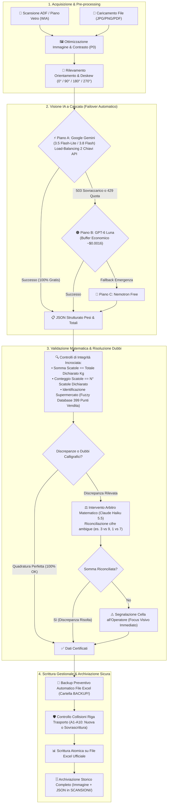

# Banco Alimentare — Gestione Schede Colletta Alimentare (MOD. A)

Applicazione desktop per Windows per l'acquisizione automatica da scanner ADF/Piano Vetro o file, l'estrazione tramite **Intelligenza Artificiale di Visione a Cascata**, la validazione matematica delle somme e la scrittura diretta delle **schede corriere (MOD. A)** all'interno dei file Excel gestionali durante la **Giornata Nazionale della Colletta Alimentare**.

<div align="center">

[-success?style=for-the-badge&logo=github)](https://github.com/John-Hole/banco-alimentare-gestione-schede/archive/refs/heads/main.zip)
[](https://github.com/John-Hole/banco-alimentare-gestione-schede/releases)

</div>

---

## 🚀 1. Download e Avvio Rapido (Senza Git)

Non è necessario installare Git né utilizzare il terminale per usare l'applicazione:

1. **Scarica il file ZIP pronto**:
   * Clicca su **[⬇️ Scarica Ultima Versione (.zip)](https://github.com/John-Hole/banco-alimentare-gestione-schede/archive/refs/heads/main.zip)**.
   * *In alternativa:* su GitHub clicca sul pulsante verde **`<> Code`** in alto a destra e scegli **`Download ZIP`**, oppure scarica il pacchetto dalla pagina **[Releases](https://github.com/John-Hole/banco-alimentare-gestione-schede/releases)**.
2. **Estrai la cartella ZIP**:
   * Fai clic destro sul file scaricato (`banco-alimentare-gestione-schede-main.zip`) e seleziona **Estrai tutto...** (es. sul Desktop o nella cartella desiderata).
3. **Avvia con 1 clic**:
   * Fai doppio clic su **`AVVIA_BANCO_ALIMENTARE.bat`**.
   * Se è il **1° avvio** sul PC e mancano le librerie Python, lo script le scarica e installa automaticamente da `APP_DATA\requirements.txt`, avviando subito il programma.
4. **Configura le chiavi API al primo avvio**:
   * **Sblocco Rapido con Password**: inserisci la password segreta nel riquadro *"🔐 Sblocco Rapido Profilo"* per attivare istantaneamente le chiavi cifrate preimpostate.
   * **Inserimento Manuale**: in alternativa, puoi incollare le tue chiavi personali (Google AI Studio Gemini e/o OpenRouter) in `⚙️ Impostazioni -> 🔑 Chiavi API`.

---

## 🔄 2. Architettura del Sistema e Flusso Operativo



---

### 2.1 Cosa va a prendere dalla Scheda (Estrazione e Controlli)

L'applicazione esamina la scheda cartacea del corriere (**MOD. A**) ed estrae con precisione millimetrica tutti i campi necessari alla rendicontazione:

1. **Dati Anagrafici e Logistici**:
   * **Supermercato di Appartenenza**: legge l'intestazione stampata o il timbro manuale a inchiostro del punto vendita. Il sistema esegue un confronto intelligente (*Fuzzy Matching*) con il database ufficiale dei **399 supermercati censiti** nei file Excel di zona, correggendo automaticamente refusi o abbreviazioni (es. *"COOP S. SISTO"* associato correttamente a *"COOP - PERUGIA C.C. IL TRIANGOLO VIA PIEVAIOLA LOC. SAN SISTO"*).
   * **Numero / Identificativo Scheda**: rileva il progressivo numerico per tracciare il documento e impedire registrazioni doppie dello stesso viaggio.
   * **Riga di Trasporto (da A1 ad A10)**: identifica la riga di assegnazione del carico del corriere, garantendo che ogni viaggio occupi la posizione corretta nel foglio del supermercato.

2. **Dati di Carico — Le 12 Categorie Alimentari Ufficiali**:
   * *Olio, Alimenti infanzia, Omogeneizzati, Pelati/Pomodoro, Legumi, Pasta, Riso, Conserve, Tonno/Carne in scatola, Latte, Biscotti, Varie*.
   * Per ciascuna colonna vengono estratti:
     - I pesi delle singole scatole caricate (dalla 1ª fino alla 10ª riga).
     - Il **Totale Kg dichiarato** dal caposquadra sul foglio.
     - Il **Numero totale di scatole dichiarato**.

---

### 2.2 Modelli di Intelligenza Artificiale Utilizzati e Strategia a Cascata

Il sistema implementa una **tecnologia a cascata resiliente** a più livelli per assicurare continuità operativa assoluta durante il giorno della raccolta, azzerando i costi senza mai rischiare il blocco dei magazzini:

* **Piano A — Google Gemini (100% Gratuito & Ultra-Rapido)**:
  * Modelli di punta: **Gemini 3.5 Flash-Lite** (primario ad altissima velocità, ~5-7 secondi) e **Gemini 3.8 Flash** (massima precisione visiva).
  * **Load-Balancing Automatico su 2 Chiavi API**: l'applicazione alterna le chiamate tra due chiavi Google indipendenti, raddoppiando il massimale gratuito giornaliero fino a **1.000 schede/giorno a costo zero**.
  * Se Google restituisce un errore di sovraccarico temporaneo (*HTTP 503: High demand*) o superamento della quota al minuto (*HTTP 429*), l'app effettua il fallback trasparente al Piano B in frazioni di secondo, senza alcuna interruzione per l'operatore.

* **Piano B — Buffer Economico OpenRouter (GPT-6 Luna)**:
  * Modello: `openai/gpt-6-luna` (con Low Reasoning).
  * Consente un'analisi visiva avanzata a un costo irrisorio (~$0.0016 a scheda). Interviene automaticamente solo se i server Google dovessero risultare temporaneamente saturi.

* **Piano C — Emergenza Gratuita (Nemotron Super-VL)**:
  * Modello: `nvidia/nemotron-3.5-super-vl:free` (100% gratuito). Rete di sicurezza aggiuntiva accessibile via OpenRouter a costo zero.

* **Piano D — Arbitro Matematico di Precisione (Claude Haiku 5.5)**:
  * Modello: `anthropic/claude-haiku-5.5` (o arbitro Gemini gratuito).
  * Interviene **solo ed esclusivamente se emergono dubbi o discrepanze di somma**, riesaminando con massima acribia logica le sole celle discordanti.

---

### 2.3 Gestione dei Numeri Scarabocchiati e Risoluzione dei Dubbi Calligrafici

Durante la Colletta le schede vengono spesso compilate all'aperto, in fretta o con penne difettose: numeri poco chiari, cancellature, occhielli chiusi e scarabocchi sono all'ordine del giorno. Il software gestisce queste complessità secondo criteri rigorosi:

1. **Principio di Non-Invenzione**:
   * L'IA è configurata con temperatura zero e rigide istruzioni negative: non tenta mai di "indovinare" o creare scatole inesistenti se non sono visibili sulla scheda originale.

2. **Riconciliazione Logico-Matematica**:
   * Quando una cifra presenta una duplice lettura plausibile (ad esempio un `3` che potrebbe sembrare un `9` per via di un occhiello superiore chiuso, oppure un `1` che potrebbe essere un `7`), l'algoritmo formula le ipotesi e verifica quale combinazione soddisfa esattamente la formula di quadratura:
     $$\sum \text{Scatole Lette} = \text{Totale Kg Dichiarato}$$
   * Se una variante calligrafica plausibile riconcilia la somma al centesimo, il sistema la adotta e registra una spiegazione trasparente nelle note (es: *"Pasta: la cifra della 1ª scatola è stata interpretata come 9 anziché 3 perché la somma (9+8+7+6+5=35) quadra esattamente con i 35 kg dichiarati dal volontario"*).

3. **Intervento dell'Arbitro Matematico**:
   * Se la prima lettura lascia discrepanze irrisolte, viene ritagliata e inviata all'Arbitro (`Claude Haiku 5.5`) la sola porzione di foglio con le colonne dubbie. L'arbitro applica un ragionamento focalizzato per verificare la consistenza tra tratti della penna e totale algebrico.

4. **Zero Errori Silenti (Sicurezza Totale)**:
   * Qualora nessuna lettura plausibile riesca a sanare la differenza matematica, l'applicazione **non forza mai il salvataggio**: la riga viene evidenziata in giallo/arancione con lo stato **`✗`**, indicando l'esatta differenza in kg e scatole. Il cursore si posiziona automaticamente sulla cella per consentire all'operatore un controllo visivo immediato con la scheda a schermo prima della conferma.

---

### 2.4 Come Agisce sui File Excel Gestionali (Integrità e Sicurezza)

La salvaguardia dei file Excel ufficiali della Colletta è garantita a livello architetturale:

* **Controllo Preventivo del File**: all'apertura, l'applicazione scansiona la cartella Excel e mappa i 21 file di zona e i 399 supermercati. Seleziona automaticamente il file corretto in base alla provenienza del carico.
* **Backup Preventivo Automatico**: prima di apportare qualsiasi modifica a un file Excel, il sistema genera istantaneamente una copia di backup protetta nella cartella `BACKUP/` con marca temporale (`backup_YYYYMMDD_HHMMSS_NomeFoglio.xls`). In caso di interruzione di corrente o errore umano, il file originale è ripristinabile in 1 secondo.
* **Controllo Collisioni delle Righe (da A1 ad A10)**:
  * Se la riga indicata dal corriere contiene già dei dati sul foglio Excel (ad esempio una registrazione precedente dello stesso mezzo), il programma blocca la sovrascrittura accidentale e mostra un avviso chiaro:
    * *"La riga A1 contiene già dei dati. La prima riga libera è A2. Vuoi registrarla su A2 oppure sovrascrivere A1?"*
* **Scrittura Atomica e Non Distruttiva**: i valori numerici vengono scritti direttamente nelle celle designate preservando intatte tutte le formule master, i totali generali di zona, i formati grafici e le macro istituzionali del file.
* **Archivio Storico Completo di Tracciabilità**: per ogni scheda confermata, nella cartella `SCANSIONI/` vengono salvati:
  1. Il file immagine nitido della scheda (ottimizzato e raddrizzato).
  2. Il file `.json` associato contenente tutti i pesi registrati, il supermercato, la data/ora, il modello IA utilizzato e le note contabili.

---

## 📁 3. Struttura Pulita della Cartella

Chi apre la cartella principale visualizza **solo i file e le cartelle operative**, mentre tutto il codice e i file tecnici rimangono ordinatamente racchiusi in `APP_DATA/`:

```text
banco-alimentare-gestione-schede/
├── AVVIA_BANCO_ALIMENTARE.bat    # Unico file da cliccare per avviare (installa da solo le librerie al 1° avvio)
├── COME_INSTALLARE.txt           # Istruzioni veloci di primo avvio
├── README.md                     # Questa guida completa
├── .gitignore                    # Protegge chiavi API, file personali e temporanei
├── BACKUP/                       # Cartella di salvataggio dei backup automatici dei file Excel
├── SCANSIONI/                    # Cartella di archiviazione delle scansioni acquisite
├── FOGLI_COLLETTA/               # Cartella dei file Excel dei supermercati di zona
└── APP_DATA/                     # Motore dell'applicazione e componenti di sistema
    ├── main.py
    ├── requirements.txt
    ├── config.template.json
    ├── colletta_index.json
    ├── gestionale_banco_alimentare_MASTER.xlsx
    ├── PROMPT_INTELLIGENZA_ARTIFICIALE.md
    ├── src/                      # Codice sorgente (interfaccia, scanner, IA, excel, validazione)
    └── tests/                    # Suite di test automatici
```

---

## 🧪 4. Esecuzione dei Test Automatici

Per verificare l'integrità di tutti i moduli dell'applicazione:

```powershell
python -m unittest discover -s APP_DATA/tests -p "test_*.py" -t APP_DATA
```
