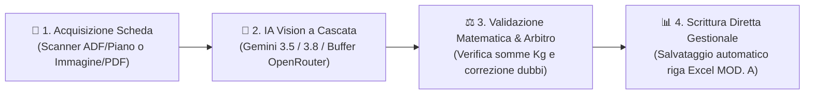

# Banco Alimentare — Gestione Schede Colletta Alimentare (MOD. A)

Applicazione desktop per Windows per l'acquisizione automatica da scanner ADF/Piano Vetro o file, l'estrazione tramite **Intelligenza Artificiale di Visione a Cascata**, la validazione matematica delle somme e la scrittura diretta delle **schede corriere (MOD. A)** all'interno dei file Excel gestionali durante la **Giornata Nazionale della Colletta Alimentare**.

<div align="center">

[-success?style=for-the-badge&logo=github)](https://github.com/John-Hole/banco-alimentare-gestione-schede/archive/refs/heads/main.zip)
[](https://github.com/John-Hole/banco-alimentare-gestione-schede/releases)

</div>

---

## 🚀 1. Download e Avvio Rapido (Senza Git)

Non è necessario installare Git né utilizzare il terminale per usare l'applicazione:

1. **Scarica il file ZIP pronto**:
   * Clicca su **[⬇️ Scarica Ultima Versione (.zip)](https://github.com/John-Hole/banco-alimentare-gestione-schede/archive/refs/heads/main.zip)**.
   * *In alternativa:* su GitHub clicca sul pulsante verde **`<> Code`** in alto a destra e scegli **`Download ZIP`**, oppure scarica il pacchetto dalla pagina **[Releases](https://github.com/John-Hole/banco-alimentare-gestione-schede/releases)**.
2. **Estrai la cartella ZIP**:
   * Fai clic destro sul file scaricato (`banco-alimentare-gestione-schede-main.zip`) e seleziona **Estrai tutto...** (es. sul Desktop o nella cartella desiderata).
3. **Avvia con 1 clic**:
   * Fai doppio clic su **`AVVIA_BANCO_ALIMENTARE.bat`**.
   * Se è il **1° avvio** sul PC e mancano le librerie Python, lo script le scarica e installa automaticamente da `APP_DATA\requirements.txt`, avviando subito il programma.
4. **Configura le chiavi API al primo avvio**:
   * **Sblocco Rapido con Password**: inserisci la password segreta nel riquadro *"🔐 Sblocco Rapido Profilo"* per attivare istantaneamente le chiavi cifrate preimpostate.
   * **Inserimento Manuale**: in alternativa, puoi incollare le tue chiavi personali (Google AI Studio Gemini e/o OpenRouter) in `⚙️ Impostazioni -> 🔑 Chiavi API`.

---

## 🔄 2. Come Funziona (Schema Rapido)



* **1. Acquisizione**: Carica le schede direttamente dallo scanner tramite alimentatore ADF (fogli continui) o piano di vetro, oppure trascinando file immagine/PDF già acquisiti.
* **2. Lettura IA a Cascata**: I modelli di intelligenza artificiale di visione leggono le caselle scritte a mano e compilano automaticamente pesi, categorie e codice del supermercato. Se un modello è sovraccarico o indisponibile, il sistema commuta istantaneamente e in automatico sul modello di riserva.
* **3. Validazione & Arbitro**: Il motore calcola in tempo reale le somme delle scatole rispetto ai totali dichiarati sul foglio. In presenza di dubbi calligrafici o discrepanze, un arbitro di precisione riesamina solo le celle interessate per conciliare matematicamente i dati.
* **4. Scrittura su Excel**: Premendo `Ctrl+Invio` tutti i valori validati vengono trascritti istantaneamente nella riga corretta del supermercato sul file Excel della Colletta.

---

## 📁 3. Struttura Pulita della Cartella

Chi apre la cartella principale visualizza **solo i file e le cartelle operative**, mentre tutto il codice e i file tecnici rimangono ordinatamente racchiusi in `APP_DATA/`:

```text
banco-alimentare-gestione-schede/
├── AVVIA_BANCO_ALIMENTARE.bat    # Unico file da cliccare per avviare (installa da solo le librerie al 1° avvio)
├── COME_INSTALLARE.txt           # Istruzioni veloci di primo avvio
├── README.md                     # Questa guida
├── .gitignore                    # Protegge chiavi API, file personali e temporanei
├── BACKUP/                       # Cartella di salvataggio dei backup automatici dei file Excel
├── SCANSIONI/                    # Cartella di archiviazione delle scansioni acquisite
├── FOGLI_COLLETTA/               # Cartella dei file Excel dei supermercati di zona
└── APP_DATA/                     # Motore dell'applicazione e componenti di sistema
    ├── main.py
    ├── requirements.txt
    ├── config.template.json
    ├── colletta_index.json
    ├── gestionale_banco_alimentare_MASTER.xlsx
    ├── PROMPT_INTELLIGENZA_ARTIFICIALE.md
    ├── src/                      # Codice sorgente (interfaccia, scanner, IA, excel, validazione)
    └── tests/                    # Suite di test automatici
```

---

## 🧪 4. Esecuzione dei Test Automatici

Per verificare l'integrità di tutti i moduli dell'applicazione:

```powershell
python -m unittest discover -s APP_DATA/tests -p "test_*.py" -t APP_DATA
```
