# Banco Alimentare — Gestione Schede Colletta Alimentare (MOD. A)

Applicazione desktop per Windows per l'acquisizione automatica da scanner ADF/Piano Vetro o file, l'estrazione tramite **Intelligenza Artificiale di Visione a Cascata**, la validazione matematica delle somme e la scrittura diretta delle **schede corriere (MOD. A)** all'interno dei file Excel gestionali durante la **Giornata Nazionale della Colletta Alimentare**.

<div align="center">

[-success?style=for-the-badge&logo=github)](https://github.com/John-Hole/banco-alimentare-gestione-schede/archive/refs/heads/main.zip)
[](https://github.com/John-Hole/banco-alimentare-gestione-schede/releases)

</div>

---

## 🚀 1. Download e Avvio Rapido (Senza Git)

Non è necessario installare Git né utilizzare il terminale per usare l'applicazione:

1. **Scarica il file ZIP pronto**:
   * Clicca su **[⬇️ Scarica Ultima Versione (.zip)](https://github.com/John-Hole/banco-alimentare-gestione-schede/archive/refs/heads/main.zip)**.
   * *In alternativa:* su GitHub clicca sul pulsante verde **`<> Code`** in alto a destra e scegli **`Download ZIP`**, oppure scarica il pacchetto dalla pagina **[Releases](https://github.com/John-Hole/banco-alimentare-gestione-schede/releases)**.
2. **Estrai la cartella ZIP**:
   * Fai clic destro sul file scaricato (`banco-alimentare-gestione-schede-main.zip`) e seleziona **Estrai tutto...** (es. sul Desktop o nella cartella desiderata).
3. **Avvia con 1 clic**:
   * Fai doppio clic su **`AVVIA_BANCO_ALIMENTARE.bat`**.
   * Se è il **1° avvio** sul PC e mancano le librerie Python, lo script le scarica e installa automaticamente da `APP_DATA\requirements.txt`, avviando subito il programma.
4. **Configura le chiavi API al primo avvio**:
   * **Sblocco Rapido con Password**: inserisci la password segreta nel riquadro *"🔐 Sblocco Rapido Profilo"* per attivare in un colpo solo sia le chiavi IA sia l'invio automatico verso Trello (nessuna impostazione manuale richiesta ai volontari).
   * **Inserimento Manuale**: in alternativa, puoi incollare le tue chiavi personali (Google AI Studio Gemini e/o OpenRouter) in `⚙️ Impostazioni -> 🔑 Chiavi API`.

---

## 🔄 2. Architettura del Sistema e Flusso Operativo

```mermaid
flowchart TD
    subgraph S1["1. Acquisizione & Taratura Uniforme"]
        A1["📄 Scansione ADF / Piano Vetro (WIA)"] --> A2["📐 Normalizzazione Geometrica (Ritaglio/Orientamento/Deskew)<br/>+ Taratura Slider (Luminosità / Contrasto fino 3.00x / Nitidezza)"]
        A3["📁 Caricamento File (JPG/PNG/PDF)"] --> A2
        A2 --> A4["💾 Backup .raw.jpg + Grezza iniziale in SCANSIONI/AAAA-MM-GG/_da_assegnare/"]
    end

    subgraph S2["2. Visione IA a Cascata Personalizzabile (3 Sezioni)"]
        A4 --> B1{"🆓 Sezione 1 — Google Gemini Free<br/>(Gemini 3.5 Flash-Lite Gratis)<br/>Load-Balancing 2 Chiavi API"}
        B1 -- "Successo (100% Gratis)" --> C1["📋 JSON Strutturato Pesi & Totali"]
        B1 -- "503 Sovraccarico o 429 Quota" --> B2{"💳 Sezione 2 — OpenRouter a Pagamento<br/>(Default: Meta Muse Ember Minimal · opp. Haiku 5.5 / Entrambi / OFF)"}
        B2 -- "Successo" --> C1
        B2 -- "Disattivato o Fallback" --> B3["🪂 Sezione 3 — Fallback Gratuito<br/>(Nemotron 3.5 Super-VL Free / OFF)"]
        B3 --> C1
    end

    subgraph S3["3. Validazione Matematica & Doppio Controllo Arbitro"]
        C1 --> C2["🔍 Controlli Incrociati:<br/>• Somma Scatole == Totale Dichiarato Kg<br/>• Conteggio Scatole == N° Scatole Dichiarato<br/>• Identificazione Supermercato (399 Punti Vendita)"]
        C2 --> C3{"Discrepanze o Dubbi Calligrafici?"}
        C3 -- "Quadratura Perfetta (100% OK)" --> D1["✅ Dati Certificati"]
        C3 -- "Discrepanza Rilevata" --> C4{"⚖️ Switch Arbitro Matematico:<br/>• Su Modelli Gratis: ON (Default)<br/>• Su Modelli a Pagamento: OFF (Default)"}
        C4 -- "Attivo sul livello vincitore" --> C5["⚖️ Arbitro Matematico Riesamina Celle Dubbie"]
        C5 --> D1
        C4 -- "Disattivato su quel livello" --> C6["⚠️ Segnalazione Cella all'Operatore (Focus Visivo Immediato)"]
        C6 --> D1
    end

    subgraph S4["4. Scrittura Gestionale & Archivio Data → Supermercato"]
        D1 --> E1["📂 Spostamento Immediato Grezza in SCANSIONI/AAAA-MM-GG/Supermercato/"]
        E1 --> E2["💾 Backup Preventivo File Excel (BACKUP/) + Controllo Collisioni (A1-A10)"]
        E2 --> E3["📊 Scrittura Atomica su File Excel Ufficiale"]
        E3 --> E4["🗄️ Archiviazione Finale (Elaborata + _dati.json + Grezza) nella stessa cartella"]
    end
```



---

### 2.1 Cosa va a prendere dalla Scheda (Estrazione e Controlli)

L'applicazione esamina la scheda cartacea del corriere (**MOD. A**) ed estrae con precisione millimetrica tutti i campi necessari alla rendicontazione:

1. **Dati Anagrafici e Logistici**:
   * **Supermercato di Appartenenza**: legge l'intestazione stampata o il timbro manuale a inchiostro del punto vendita. Il sistema esegue un confronto intelligente (*Fuzzy Matching*) con il database ufficiale dei **399 supermercati censiti** nei file Excel di zona, correggendo automaticamente refusi o abbreviazioni (es. *"COOP S. SISTO"* associato correttamente a *"COOP - PERUGIA C.C. IL TRIANGOLO VIA PIEVAIOLA LOC. SAN SISTO"*).
   * **Numero / Identificativo Scheda**: rileva il progressivo numerico per tracciare il documento e impedire registrazioni doppie dello stesso viaggio.
   * **Riga di Trasporto (da A1 ad A10)**: identifica la riga di assegnazione del carico del corriere, garantendo che ogni viaggio occupi la posizione corretta nel foglio del supermercato.

2. **Dati di Carico — Le 13 Categorie Alimentari Ufficiali**:
   * *Omogeneizzati, Alimenti per bambini, Tonno, Olio, Pelati, Legumi, Pasta, Riso, Zucchero, Latte, Biscotti, Carne in scatola, Varie*.
   * Per ciascuna colonna vengono estratti:
     - I pesi delle singole scatole caricate (dalla 1ª fino alla 10ª riga).
     - Il **Totale Kg dichiarato** dal caposquadra sul foglio.
     - Il **Numero totale di scatole dichiarato**.

---

### 2.2 Strategia IA a Cascata Personalizzabile (3 Sezioni) & Arbitro a Doppio Switch

Il sistema implementa una **cascata personalizzabile in 3 sezioni indipendenti** configurabile da `⚙️ Impostazioni -> 🚀 Flusso IA & Modelli` (la scelta del provider viene memorizzata anche ai riavvii successivi):

1. **Sezione 1 — Modello Google Gemini (100% Gratuito)**:
   * **Gemini 3.5 Flash-Lite** ad altissima velocità e zero costi (oppure disattivato). *Nota: Gemini 3.8 Flash rimane disponibile in alto come modello fisso singolo dedicato*.
   * **Load-Balancing Automatico su 2 Chiavi API**: l'applicazione alterna le chiamate tra due chiavi Google indipendenti, raddoppiando la capacità gratuita fino a **1.000 schede/giorno a costo zero**.
2. **Sezione 2 — Buffer a Pagamento OpenRouter (Opzionale)**:
   * Subentra solo se Google restituisce errori temporanei (*HTTP 503*) o esaurisce le quote giornaliere (*HTTP 429*).
   * Configurabile tra **Meta Muse Ember Minimal** (*Default economico ~$0.0010/scheda*), **Claude Haiku 5.5 Low**, entrambi nell'ordine preferito, oppure **⚪ Disattivato** (nessuna spesa automatica garantita).
3. **Sezione 3 — Fallback Gratuito Finale OpenRouter**:
   * **Nemotron 3.5 Super-VL Free** (`nvidia/nemotron-3.5-super-vl:free`, default attivo) o **⚪ Disattivato**. Funziona da paracadute a costo zero se anche la Sezione 2 non è disponibile o disattivata.
4. **Arbitro Matematico con 2 Switch Indipendenti**:
   * **Switch "Arbitro su modelli Gratis"** (**ON di default**): se una scheda letta gratis (Gemini/Nemotron) ha una quadratura matematica dubbia, l'Arbitro (**Claude Haiku 5.5 Low** di default o modello scelto) riesamina le cifre ambigue.
   * **Switch "Arbitro dopo modelli a Pagamento"** (**OFF di default**): evita costi aggiuntivi non richiesti quando la lettura proviene già da `Ember` o `Haiku` (le discrepanze vengono comunque evidenziate subito all'operatore).
   * **Claude Sonnet 5.5** rimane protetto e invocabile **solo manualmente** con `Shift + Click` su *Rianalizza IA* o `Ctrl+Shift+R`.

> **Nota Scanner & Taratura Immagini**: il pre-processing esegue esclusivamente normalizzazione geometrica (ritaglio bordi bianchi, orientamento, deskew) e applica esattamente gli slider di **Luminosità / Contrasto (fino a 3.00x) / Nitidezza** configurati nelle Impostazioni in modo uniforme su **Anteprima**, **ADF**, **Piano Vetro** e **PDF/File da disco**, senza curve gamma nascoste e preservando sempre l'originale `.raw.jpg`. Un **doppio clic rapido su `↺ Reset`** nella barra immagine ripristina all'istante l'immagine grezza non tarata per la sola scheda corrente.

---

### 2.3 Gestione dei Numeri Scarabocchiati e Risoluzione dei Dubbi Calligrafici

Durante la Colletta le schede vengono spesso compilate all'aperto, in fretta o con penne difettose: numeri poco chiari, cancellature, occhielli chiusi e scarabocchi sono all'ordine del giorno. Il software gestisce queste complessità secondo criteri rigorosi:

1. **Principio di Non-Invenzione**:
   * L'IA è configurata con temperatura zero e rigide istruzioni negative: non tenta mai di "indovinare" o creare scatole inesistenti se non sono visibili sulla scheda originale.

2. **Riconciliazione Logico-Matematica**:
   * Quando una cifra presenta una duplice lettura plausibile (ad esempio un `3` che potrebbe sembrare un `9` per via di un occhiello superiore chiuso, oppure un `1` che potrebbe essere un `7`), l'algoritmo formula le ipotesi e verifica quale combinazione soddisfa esattamente la formula di quadratura:
     $$\sum \text{Scatole Lette} = \text{Totale Kg Dichiarato}$$
   * Se una variante calligrafica plausibile riconcilia la somma al centesimo, il sistema la adotta e registra una spiegazione trasparente nelle note (es: *"Pasta: la cifra della 1ª scatola è stata interpretata come 9 anziché 3 perché la somma (9+8+7+6+5=35) quadra esattamente con i 35 kg dichiarati dal volontario"*).

3. **Intervento dell'Arbitro Matematico**:
   * Quando attivo sul livello che ha eseguito l'estrazione e in presenza di discrepanze irrisolte, viene riesaminata la scheda con un prompt focalizzato alla verifica tra tratti della penna e totali algebrici.

4. **Zero Errori Silenti (Sicurezza Totale)**:
   * Qualora nessuna lettura plausibile riesca a sanare la differenza matematica, l'applicazione **non forza mai il salvataggio**: la riga viene evidenziata in giallo/arancione con lo stato **`✗`**, indicando l'esatta differenza in kg e scatole. Il cursore si posiziona automaticamente sulla cella per consentire all'operatore un controllo visivo immediato con la scheda a schermo prima della conferma.

---

### 2.4 Come Agisce sui File Excel Gestionali e Archiviazione Gerarchica

La salvaguardia dei file Excel ufficiali e delle scansioni della Colletta è garantita a livello architetturale:

* **Controllo Preventivo del File**: all'apertura, l'applicazione scansiona la cartella Excel e mappa i 21 file di zona e i 399 supermercati. Seleziona automaticamente il file corretto in base alla provenienza del carico.
* **Backup Preventivo Automatico**: prima di apportare qualsiasi modifica a un file Excel, il sistema genera istantaneamente una copia di backup protetta nella cartella `BACKUP/` con marca temporale (`backup_YYYYMMDD_HHMMSS_NomeFoglio.xls`).
* **Controllo Collisioni delle Righe (da A1 ad A10)**: se la riga indicata dal corriere contiene già dei dati sul foglio Excel, il programma blocca la sovrascrittura accidentale e propone la prima riga libera oppure la sovrascrittura consapevole.
* **Scrittura Atomica e Non Distruttiva**: i valori numerici vengono scritti direttamente nelle celle designate preservando formule master, totali generali e macro istituzionali.
* **Archivio Storico Gerarchico (`SCANSIONI/<AAAA-MM-GG>/<Supermercato>/`)**:
  1. Appena una scheda viene scansionata (ADF/Piano Vetro) o caricata da disco/PDF, la copia grezza intatta viene salvata in `SCANSIONI/<AAAA-MM-GG>/_da_assegnare/`.
  2. Non appena l'IA riconosce l'insegna (anche sui fogli in coda) — o quando l'operatore seleziona/cambia manualmente il foglio — la scansione grezza viene **spostata subito** in `SCANSIONI/<AAAA-MM-GG>/<Supermercato>/` (oppure in `_non_riconosciuto/` se priva di insegna).
  3. Alla conferma e scrittura su Excel, nella stessa cartella del supermercato vengono salvati l'immagine elaborata finale e il file `_dati.json` completo, mantenendo aggiornato l'indice globale `SCANSIONI/indice_storico.json`.

---

### 2.5 💡 Consigli e Segnalazioni Rapide (Senza Login)

La sezione **`💡 Consigli`** è disponibile direttamente dentro **`⚙️ Impostazioni -> 💡 Consigli`** (ed è raggiungibile anche dalla voce nel menu **`☰ Altre Opzioni -> 💡 Invia Consiglio / Segnalazione...`**):

* **Zero Login & Funzionamento Offline-First**: qualsiasi volontario può annotare un suggerimento o un problema in 5 secondi; ogni invio viene registrato immediatamente come task Markdown (`- [ ] ...`) in `SUGGERIMENTI/task_suggerimenti_<ANNO>.md` e visualizzato nella lista della scheda stessa.
* **Integrazione Trello Automatica**: lo *"Sblocco Rapido Profilo"* attiva in un colpo solo sia le chiavi IA sia l'invio automatico verso la bacheca Trello del team (nessuna impostazione manuale richiesta ai volontari; opzioni avanzate riservate all'amministratore in `⚙️ Impostazioni -> 🚀 Flusso IA & Modelli`, più coda locale con tasto *Invia Pendenti Trello* se offline).
* **Template Issue GitHub in Italiano**: disponibile il collegamento diretto ai moduli guidati in `.github/ISSUE_TEMPLATE/` (*Suggerimento* / *Segnalazione Bug*).

---

## 📁 3. Struttura Pulita della Cartella

Chi apre la cartella principale visualizza **solo i file e le cartelle operative**, mentre tutto il codice e i file tecnici rimangono ordinatamente racchiusi in `APP_DATA/`:

```text
banco-alimentare-gestione-schede/
├── AVVIA_BANCO_ALIMENTARE.bat    # Unico file da cliccare per avviare (installa le librerie al 1° avvio)
├── COME_INSTALLARE.txt           # Istruzioni veloci di primo avvio
├── README.md                     # Questa guida completa
├── .gitignore                    # Protegge chiavi API, suggerimenti personali e temporanei
├── .github/
│   └── ISSUE_TEMPLATE/           # Moduli italiani per segnalazioni e suggerimenti su GitHub
├── BACKUP/                       # Backup automatici preventivi dei file Excel
├── SCANSIONI/                    # Archivio gerarchico delle scansioni acquisite
│   ├── <AAAA-MM-GG>/             # Cartella della giornata di raccolta
│   │   ├── _da_assegnare/        # Scansioni grezze in attesa di lettura IA
│   │   └── <Supermercato>/       # Copia grezza, scheda elaborata finale e file _dati.json
│   └── indice_storico.json       # Indice master di tutte le schede archiviate
├── SUGGERIMENTI/                 # Task checklist locali ('task_suggerimenti_<ANNO>.md')
├── FOGLI_COLLETTA/               # Cartella dei file Excel dei supermercati di zona
└── APP_DATA/                     # Motore dell'applicazione e componenti di sistema
    ├── main.py
    ├── requirements.txt
    ├── config.template.json
    ├── colletta_index.json
    ├── gestionale_banco_alimentare_MASTER.xlsx
    ├── PROMPT_INTELLIGENZA_ARTIFICIALE.md
    ├── src/                      # Codice sorgente (interfaccia, scanner, IA, excel, validazione, feedback)
    └── tests/                    # Suite completa di test automatici
```
